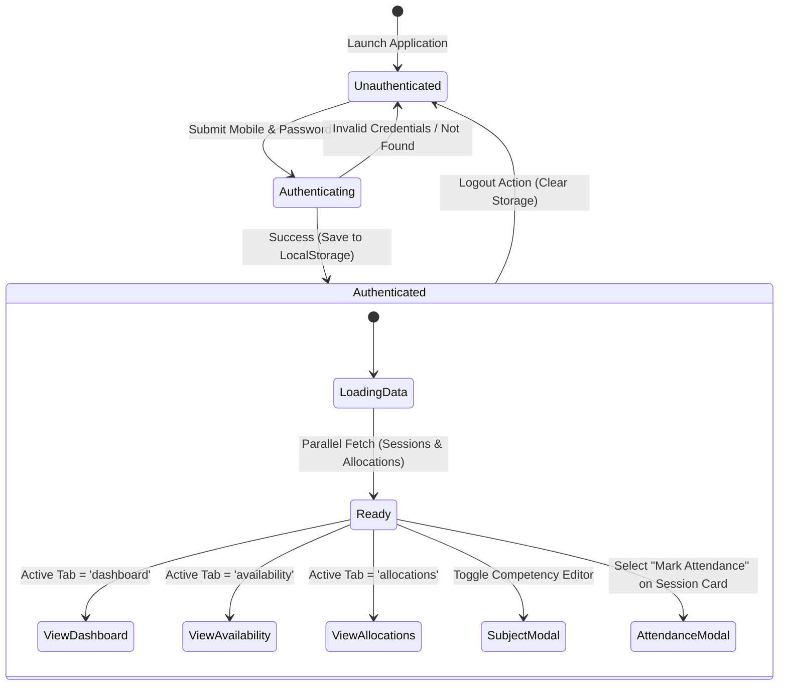

# 🎓 TRP - Teacher Reporting Portal (Complete Project Prototype Specification)

This document provides a comprehensive functional, technical, and architectural specification for the **TRP (Teacher Reporting Portal)**. It is designed to serve as a complete blueprint for rebuilding, extending, or recreating the user interface across any frontend stack (e.g., Next.js, Vue, Svelte, React Native, Flutter, Shadcn/UI, or Mobile Native).

---

## 📌 Table of Contents

1. [Executive Summary & Purpose](#1-executive-summary--purpose)
2. [System Architecture & Data Flows](#2-system-architecture--data-flows)
3. [Domain Models & Data Schemas](#3-domain-models--data-schemas)
4. [Backend API Specifications (Google Apps Script Webhooks)](#4-backend-api-specifications-google-apps-script-webhooks)
5. [State Management & Authentication Lifecycle](#5-state-management--authentication-lifecycle)
6. [UI/UX Component & View Blueprints](#6-uiux-component--view-blueprints)
   - [6.1 Authentication Screen](#61-authentication-screen)
   - [6.2 App Layout & Header Navigation](#62-app-layout--header-navigation)
   - [6.3 Session Dashboard & Real-Time Counters](#63-session-dashboard--real-time-counters)
   - [6.4 Real-Time Attendance & Session Log Modal](#64-real-time-attendance--session-log-modal)
   - [6.5 Weekly Availability Scheduler](#65-weekly-availability-scheduler)
   - [6.6 Student Allocation Roster](#66-student-allocation-roster)
   - [6.7 Subject & Competency Manager](#67-subject--competency-manager)
   - [6.8 Password Reset Dialog](#68-password-reset-dialog)
7. [Design System & UI Tokens](#7-design-system--ui-tokens)
8. [Implementation Guide for Building Alternative UIs](#8-implementation-guide-for-building-alternative-uis)

---

## 1. Executive Summary & Purpose

The **Teacher Reporting Portal (TRP)** is an enterprise academic dashboard built for **Edstaq – The Learning Network**. It streamlines daily operational tasks for live online tutors.

### Key Goals:
* **Schedule & Live Classroom Access:** Instant visibility into allocated live classes with one-click Google Meet launch.
* **Live Attendance & Micro-Evaluations:** Attendance marking (`Present`/`Absent`), 1–5 star student engagement ratings, and lesson topic notes.
* **Document & Proof Management:** Drive integration for submitting lesson notes ("Learn Docs") and class screenshot proofs ("Session Proof").
* **Availability Management:** Self-service weekly slot management for scheduling class allocations.
* **Competency Customization:** Subject and syllabus (CBSE, Kerala State, English/Malayalam medium) profile updates.

---

## 2. System Architecture & Data Flows

```mermaid
graph TD
    Client[TRP Frontend Client UI]
    
    subgraph Services Layer
        AuthSvc[Teacher Auth Service]
        SessSvc[Session Service]
        AttSvc[Attendance / Student Log Service]
        AvailSvc[Availability Service]
        AllocSvc[Allocation Service]
        SubjSvc[Subject Catalog Service]
    end
    
    subgraph Webhook Endpoints (Google Apps Script)
        EP_TCH[Teacher Webhook Endpoint]
        EP_SES[Session Webhook Endpoint]
        EP_LOG[Student Log Webhook Endpoint]
        EP_AVL[Availability Webhook Endpoint]
        EP_ALL[Allocation Webhook Endpoint]
        EP_SUB[Subject Webhook Endpoint]
    end

    subgraph External Systems
        GSheets[(Google Sheets Database)]
        GDrive[Google Drive Storage]
        GMeet[Google Meet Rooms]
        WA[WhatsApp Support / Referral]
    end

    Client --> AuthSvc & SessSvc & AttSvc & AvailSvc & AllocSvc & SubjSvc
    AuthSvc --> EP_TCH
    SessSvc --> EP_SES
    AttSvc --> EP_LOG
    AvailSvc --> EP_AVL
    AllocSvc --> EP_ALL
    SubjSvc --> EP_SUB

    EP_TCH & EP_SES & EP_LOG & EP_AVL & EP_ALL & EP_SUB -->|Read / Write| GSheets
    Client -->|Upload File Links| GDrive
    Client -->|Launch Live Class| GMeet
    Client -->|Trigger Reschedule / Refer| WA
```

---

## 3. Domain Models & Data Schemas

### 3.1 TypeScript Type Definitions

```typescript
export enum SessionStatus {
  UPCOMING = 'UPCOMING',
  IN_PROGRESS = 'IN_PROGRESS',
  COMPLETED = 'COMPLETED'
}

export interface Student {
  id: string;
  name: string;
  attended: boolean;
  listeningRate: number; // 1-5 rating scale
  review: string;       // Custom notes/feedback
}

export interface SessionFile {
  timestamp: string;
  email: string;
  sessionId: string;
  fileName: string;
  uploadFile: string;   // Google Drive URL
  type: 'Learn Docs' | 'Session Proof';
}

export interface SubjectCatalogItem {
  id: string;
  category: string;
  board: string;         // e.g., 'CBSE', 'Kerala State'
  level: string;
  department: string;
  stage: string;         // e.g., 'LP', 'UP', 'HS', 'HSS'
  name: string;
  description: string;
  code: string;
  tags: string[];
  status: string;
  price: number;
  teacherIds: string[];
  label?: string;
}

export interface Session {
  id: string;
  sessionId: string;
  allocationId?: string;
  subject: string;
  className: string;
  startTime: string;      // ISO Date String
  durationMinutes: number;
  status: SessionStatus;
  students: Student[];
  files: SessionFile[];
  meetLink?: string;
  topicCovered?: string;
  startedTime?: string;
  endedTime?: string;
}

export interface AvailabilitySlot {
  id?: string;
  start: string; // HH:mm format (24h)
  end: string;   // HH:mm format (24h)
}

export interface Availability {
  day: 'Monday' | 'Tuesday' | 'Wednesday' | 'Thursday' | 'Friday' | 'Saturday' | 'Sunday';
  slots: AvailabilitySlot[];
}

export interface TeacherProfile {
  id: string;            // TCH ID (e.g. TCH-1002)
  name: string;
  email: string;
  mobile: string;
  subjects: string[];    // Array of Subject IDs
  availability: Availability[];
  status?: 'Active' | 'In-Active';
}

export interface Allocation {
  assignId: string;
  classRoomId: string;
  meetLink: string;
  subjectId: string;
  subjectLabel?: string;
  studentIds: string[];
  studentNames: string[];
  teacherId: string;
  startDate: string;
  sessionsPerDay: number;
  startTime: string;
  endTime: string;
  days: string;          // e.g. "Mon, Wed, Fri"
  status: string;
  weekCycle: number;
  isInteractive: boolean;
  endDateReq?: string;
  classCountReq?: string | number;
}
```

### 3.2 Raw API Schemas (Google Sheets Column Mapping)

```typescript
export interface ApiSession {
  "Session ID": string;
  "Session Temp Id": string;
  "Class Room ID": string;
  "Teacher Assign ID": string;
  "Student ID": string;
  "Subject ID": string;
  "Teacher ID": string;
  "Date": string;
  "Start Time": string;
  "End Time": string;
  "Status": 'Upcoming' | 'In-Progress' | 'Completed';
  "Sessions per day": number;
  "Student Limit": number;
  "Subject label": string;
  "Subject name": string;
  "Class link": string;
  "Topic covered": string;
  "Started Time"?: string;
  "Ended Time"?: string;
  "Files": ApiSessionFile[];
}

export interface ApiStudentLog {
  "Timestamp"?: string;
  "Log ID"?: string;
  "Session ID": string;
  "Student ID": string;
  "Student Name"?: string;
  "Status": 'Present' | 'Absent';
  "Rating": number | string;
  "Comment": string;
}
```

---

## 4. Backend API Specifications (Google Apps Script Webhooks)

All endpoints respond with HTTP 200 containing a JSON payload formatted as:
```json
{
  "success": true,
  "message": "Operation successful",
  "data": { ... }
}
```
*Note: Due to Google Apps Script CORS constraints, request payloads are sent via HTTP `POST` using `text/plain;charset=utf-8` with JSON serialized body.*

### 4.1 Endpoints Map

| Feature | Base URL Key (`config.ts`) | Main Action Strings |
| :--- | :--- | :--- |
| **Teacher Auth & Profile** | `API_ENDPOINTS.TEACHER` | `readByContact`, `updateByContact` |
| **Subject Catalog** | `API_ENDPOINTS.SUBJECT` | `readAllSubjects`, `readSubjectsByIds` |
| **Availability** | `API_ENDPOINTS.AVAILABILITY` | `read`, `add`, `update`, `delete` |
| **Allocations** | `API_ENDPOINTS.ALLOCATION` | `readByTeacherId` |
| **Sessions** | `API_ENDPOINTS.SESSION` | `readByTeacherId`, `updateBySessionId` |
| **Student Logs** | `API_ENDPOINTS.STUDENT_LOG` | `readBySessionId`, `bulkAdd` |
| **Student Directory** | `API_ENDPOINTS.STUDENT` | `getStudentById` |

### 4.2 API Call Payloads & Examples

#### A. Teacher Login Lookup
- **URL:** `API_ENDPOINTS.TEACHER`
- **Method:** `POST`
- **Body:**
  ```json
  {
    "action": "readByContact",
    "mobile": "9876543210"
  }
  ```
- **Response `data`:** Object with `Teacher ID`, `Name`, `Mail`, `Contact`, `Password`, `Subjects ID(s)`, `Status`.

#### B. Update Teacher Profile (Subjects Competency)
- **URL:** `API_ENDPOINTS.TEACHER`
- **Method:** `POST`
- **Body:**
  ```json
  {
    "action": "updateByContact",
    "mobile": "9876543210",
    "data": {
      "Subjects ID(s)": "SUB-101, SUB-105, SUB-202"
    }
  }
  ```

#### C. Bulk Add Attendance & Session Logs
- **URL:** `API_ENDPOINTS.STUDENT_LOG`
- **Method:** `POST`
- **Body:**
  ```json
  {
    "action": "bulkAdd",
    "logs": [
      {
        "sessionId": "SES-1001",
        "studentId": "STU-501",
        "status": "Present",
        "rating": 5,
        "comment": "Participated actively in calculus problems."
      }
    ]
  }
  ```

---

## 5. State Management & Authentication Lifecycle



### LocalStorage Persistence Keys
* `isAuthenticated` (string: `'true'` | `'false'`)
* `teacherProfile` (JSON serialized `TeacherProfile`)
* `activeTab` (string: `'dashboard'` | `'availability'` | `'allocations'`)

---

## 6. UI/UX Component & View Blueprints

### 6.1 Authentication Screen
* **Layout:** Centered card with soft backdrop blur and ambient glowing background shapes.
* **Fields:**
  1. Contact Number (numeric keyboard input filter).
  2. Password (masked text input).
* **Actions:** "Sign In" button with loading spinner state.
* **Error Banner:** Inline red alert box for wrong passwords or connection failures.

### 6.2 App Layout & Header Navigation (`Layout.tsx`)
* **Header Elements:**
  * **Brand Logo & Title:** Edstaq TRP badge.
  * **Teacher Badge:** Teacher Name, ID tag, and Status indicator pill (`Active` - Green).
  * **Actions:**
    * Password change lock icon.
    * Logout button.
* **Navigation Tabs:**
  1. 📅 **Sessions Dashboard**
  2. 🗓️ **Availability Manager**
  3. 🎓 **Allocations & Students**
  4. 📚 **Subject Competency**
* **Sticky Footer:**
  * Quick WhatsApp Support button (`wa.me/917510204021`).
  * "Refer a Teacher" WhatsApp share trigger.
  * Links to Feedback & Complaint Google Forms.

### 6.3 Session Dashboard & Real-Time Counters
* **Metric Cards Grid (5 Stat Cards):**
  1. **Upcoming Sessions:** Count of status `UPCOMING`.
  2. **Live / In-Progress:** Count of status `IN_PROGRESS`.
  3. **Completed Sessions:** Count of status `COMPLETED`.
  4. **Total Students Allocated:** Unique aggregate of student IDs across allocations.
  5. **Total Hours:** Calculated sum of completed session durations.
* **Filter Pills:** `All`, `Upcoming`, `In-Progress`, `Completed`.
* **Session Cards (`SessionCard.tsx`):**
  * **Header:** Subject Name, Classroom ID tag, Status pill.
  * **Body:** Date & Time (formatted like `Mon, 14 Sep • 10:30 AM`), Duration badge (`45 mins`).
  * **Action Buttons:**
    * 🎥 **Join Class:** Opens Google Meet link in new tab.
    * 📝 **Mark Attendance / End Class:** Opens `AttendanceSheet` modal.
    * 📂 **View Learn Docs / Proofs:** Modal listing submitted file URLs.
    * 🔄 **Reschedule:** Pre-filled query trigger or form.

### 6.4 Real-Time Attendance & Session Log Modal (`AttendanceSheet.tsx`)
* **Header:** Session info (Subject, Classroom ID, Date).
* **Section 1: Lesson Topic Coverage:**
  * Required text input: *"What topic was covered today?"*
* **Section 2: Student Roster Evaluation:**
  * Table / List of students:
    * **Attendance Toggle:** `Present` (Green) / `Absent` (Red).
    * **Listening Rating:** 5-star interactive rating component.
    * **Student Notes:** Text field for progress notes.
* **Section 3: Upload Proofs / Drive Links:**
  * Input fields for Google Drive links of "Learn Docs" and "Session Screenshots".
* **Footer Action:** "Sync & Complete Session" button.

### 6.5 Weekly Availability Scheduler (`AvailabilityManager.tsx`)
* **Tab / Accordion View:** Days Monday through Sunday.
* **Slot Cards:** List of configured start-end time slots (e.g. `09:00 AM - 10:30 AM`).
* **Add Slot Form Modal:**
  * Start Time picker.
  * End Time picker.
  * Validation: End time must be after start time.
* **Actions:** Delete slot button (trash icon), instant background sync to backend API.

### 6.6 Student Allocation Roster (`AllocationDashboard.tsx`)
* **Classroom Cards:**
  * Subject label, Classroom ID, Recurring days badge, Session duration window.
  * Total Target Classes count & Target end date.
* **Expandable Student List:**
  * Student Name, Student ID, direct contact link.

### 6.7 Subject & Competency Manager (`SubjectSelectorModal.tsx`)
* **Filters Bar:**
  * Board Filter (`CBSE`, `Kerala State`).
  * Stage Filter (`LP`, `UP`, `HS`, `HSS`).
  * Search bar for subject name or code.
* **Subject Selection Grid:**
  * Checkbox/chip selection list of subjects.
* **Save Action:** Saves selected subject IDs to teacher profile and syncs to backend.

---

## 7. Design System & UI Tokens

### Color Palette

| Token Name | Color Code | Usage |
| :--- | :--- | :--- |
| `brand-navy` | `#0f172a` | Primary Brand Color, Headers, Main Buttons |
| `brand-blue` | `#3b82f6` | Active Tabs, Interactive Links, Highlights |
| `brand-gray` | `#f8fafc` | Background Slate Color |
| `status-upcoming` | `#f59e0b` (Amber) | Upcoming session status badge |
| `status-progress` | `#3b82f6` (Blue) | Live / In-Progress status badge |
| `status-completed` | `#10b981` (Emerald) | Completed status badge |
| `alert-red` | `#ef4444` (Red) | Errors, Absent status |

### Typography & Spacing
* **Font Family:** `Inter`, system-ui, `-apple-system`, `BlinkMacSystemFont`, `Segoe UI`, `Roboto`.
* **Headings:** Bold/Black font weights (`700`, `900`), tight letter spacing (`-0.025em`).
* **Micro-Labels:** Uppercase tracking (`tracking-[0.2em]`), size `9px` to `11px`, muted gray (`#94a3b8`).
* **Border Radius:** Extra large (`rounded-2xl` = `1rem`, `rounded-3xl` = `1.5rem`).

---

## 8. Implementation Guide for Building Alternative UIs

When recreating this application in another UI framework (e.g. Next.js App Router, Vue 3 Pinia, React Native, or Flutter):

1. **API Integration Layer:**
   * Re-implement the API wrappers in `services/` using standard `fetch` or `axios`.
   * Set headers to `Content-Type: text/plain;charset=utf-8` when sending POST requests to Google Apps Script.
2. **State Management:**
   * Store the active `TeacherProfile` and auth state in global state (e.g. Zustand, Redux Toolkit, Pinia, or React Context).
3. **PWA / Offline Optimizations:**
   * Cache fetched sessions and allocations in IndexedDB or AsyncStorage so teachers can view schedules offline.
4. **Form Validation:**
   * Ensure numeric-only filters for contact number during login.
   * Require `topicCovered` before allowing a session to be completed in attendance modal.

---
*Created for Edstaq TRP – Teacher Reporting Portal Blueprint*
