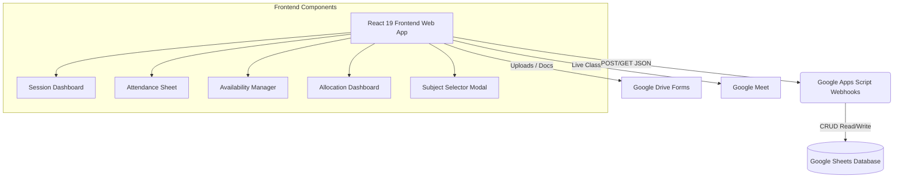

# 🎓 TRP - Teacher Reporting Portal (Teacher Sessions Tracking System)


**TRP (Teacher Reporting Portal)** is a modern, responsive web application designed for **Edstaq – The Learning Network**. It empowers educators to manage their daily teaching schedules, conduct live class sessions, record real-time student attendance and progress logs, set weekly availability slots, view student allocation details, and update subject competencies seamlessly.

---

## 📌 Table of Contents

- [Features](#-features)
- [System Architecture](#-system-architecture)
- [Tech Stack](#-tech-stack)
- [Project Directory Structure](#-project-directory-structure)
- [API Endpoints & Integration](#-api-endpoints--integration)
- [Getting Started](#-getting-started)
  - [Prerequisites](#prerequisites)
  - [Installation](#installation)
  - [Environment Variables](#environment-variables)
  - [Development Server](#development-server)
  - [Production Build](#production-build)
- [Configuration](#-configuration)
- [License & Support](#-license--support)

---

## ✨ Features

### 🔐 1. Teacher Authentication & Profile Management
- **Contact-based Login:** Secure authentication using mobile contact verification with Google Apps Script backend database lookup.
- **Persistent State:** Saves authentication session and active tabs in local storage for seamless reload experience.
- **Subject Competency Manager:** Teachers can edit and select subjects/boards (CBSE, Kerala State, English/Malayalam medium) they teach.
- **Password Management:** Secure password update modal interface.

### 📅 2. Interactive Session Dashboard & Metrics
- **Real-Time Counters:** Overview metrics displaying Upcoming Sessions, In-Progress Classes, Completed Sessions, Total Allocated Students, and Total Teaching Hours.
- **Session Cards:** Chronologically organized live session cards with direct **Google Meet** room launch links, classroom IDs, time slots, and status indicators (`UPCOMING`, `IN_PROGRESS`, `COMPLETED`).
- **Quick Action Triggers:** One-click links for session rescheduling, complaints, feedback, and referring fellow teachers via WhatsApp.

### 📝 3. Real-Time Attendance & Student Log Sheet
- **Live Class Tracking:** Mark student attendance (`Present` / `Absent`), assign 1–5 star listening ratings, and write custom feedback for each student.
- **Topic Coverage Documentation:** Record exact lesson topics covered during each session.
- **Document & Proof Attachments:** Directly attach "Learn Docs" and "Session Proof" files uploaded to Google Drive.
- **Automated Backend Sync:** Bulk syncs student logs to the Google Sheets database when ending a session.

### 🗓️ 4. Weekly Availability Manager
- **Slot Management:** Define custom available time windows per weekday (Monday through Sunday).
- **CRUD Operations:** Easily add, edit, or remove availability slots with immediate server-side sync.

### 📊 5. Student Allocation Dashboard
- **Allocated Classrooms:** Detailed view of active class allocations, subjects, recurring days, start/end times, and total target class counts.
- **Student Roster:** Searchable list of assigned students per class with contact links and progress tracker.

---

## 🏗️ System Architecture



---

## 🧪 Tech Stack

- **Frontend Framework:** [React 19](https://react.dev/)
- **Language:** [TypeScript 5.8](https://www.typescriptlang.org/)
- **Build Tool:** [Vite 6.2](https://vitejs.dev/)
- **UI & Icons:** [Lucide React](https://lucide.dev/)
- **AI Integration:** [@google/genai](https://www.npmjs.com/package/@google/genai)
- **Backend / DB:** Google Apps Script Web Apps serving REST-like JSON endpoints over Google Sheets.

---

## 📁 Project Directory Structure

```
TRP web/
├── components/                  # React UI Components
│   ├── AllocationDashboard.tsx  # Student classroom allocation view
│   ├── AttendanceSheet.tsx      # Attendance & session logging modal
│   ├── AvailabilityManager.tsx  # Weekly time slot scheduler
│   ├── ChangePasswordModal.tsx  # Password reset modal
│   ├── Layout.tsx               # Primary App Navigation & Header Shell
│   ├── LoadingPopup.tsx         # Full-screen loader overlay
│   ├── SessionCard.tsx          # Individual class session card
│   └── SubjectSelectorModal.tsx # Subject & board selection modal
├── data/
│   └── subjects.ts              # Fallback subject catalog definitions
├── services/                    # API Service Wrappers (Fetch / POST)
│   ├── allocationService.ts     # Allocation API calls
│   ├── availabilityService.ts   # Availability API calls
│   ├── sessionService.ts        # Session management API calls
│   ├── studentLogService.ts     # Student attendance log API calls
│   ├── studentService.ts        # Student details lookup
│   ├── subjectService.ts        # Subject catalog API calls
│   └── teacherService.ts        # Teacher authentication & profile API
├── App.tsx                      # Root Application & State Manager
├── API_ENDPOINTS.md             # API technical specifications
├── config.ts                    # Application configuration & Endpoint URLs
├── constants.ts                 # Constants & defaults
├── index.css                    # Global CSS styles
├── index.html                   # HTML Entry point
├── index.tsx                    # React Entry point
├── package.json                 # Project dependencies & scripts
├── types.ts                     # TypeScript Interfaces & Enums
└── vite.config.ts               # Vite configuration
```

---

## 🔌 API Endpoints & Integration

The backend relies on Google Apps Script endpoints handling JSON payloads (`text/plain;charset=utf-8` to handle CORS execution cleanly).

| Module | Webhook Execution Endpoint | Primary Actions |
| :--- | :--- | :--- |
| **Teacher** | `.../AKfycbx7NxYRzK.../exec` | `readByContact`, `updateByContact` |
| **Subject** | `.../AKfycby-zYMWd2.../exec` | `readAllSubjects`, `readSubjectsByIds` |
| **Availability** | `.../AKfycbxmTzvJIW.../exec` | `read`, `add`, `update`, `delete` |
| **Allocation** | `.../AKfycbwuzCTP0c.../exec` | `readByTeacherId` |
| **Session** | `.../AKfycbxphDk4br.../exec` | `readByTeacherId`, `updateBySessionId` |
| **Student Log** | `.../AKfycbw0OBau3M.../exec` | `readBySessionId`, `bulkAdd` |
| **Student** | `.../AKfycbwno4xusB.../exec` | `getStudentById` |

*For full API request/response format details, refer to [API_ENDPOINTS.md](file:///d:/ANTI%20GRAVITY/TRP%20web/API_ENDPOINTS.md).*

---

## 🚀 Getting Started

### Prerequisites

- **Node.js** (v18.0.0 or higher recommended)
- **npm** (v9.0.0 or higher)

### Installation

1. Clone or download the repository to your local machine:
   ```bash
   git clone <repository-url>
   cd "TRP web"
   ```

2. Install the dependencies:
   ```bash
   npm install
   ```

### Environment Variables

Create a `.env.local` file in the project root if using Gemini AI features:

```env
GEMINI_API_KEY=your_gemini_api_key_here
```

### Development Server

Start the local development server with Hot Module Replacement (HMR):

```bash
npm run dev
```

Open your browser and navigate to `http://localhost:5173`.

### Production Build

Build the project for production deployment:

```bash
npm run build
```

Preview the production build locally:

```bash
npm run preview
```

---

## ⚙️ Configuration

Application endpoints and portal settings are centralized in [`config.ts`](file:///d:/ANTI%20GRAVITY/TRP%20web/config.ts):

```typescript
export const APP_CONFIG = {
    PORTAL_INFO: {
        NAME: 'TRP',
        FULL_NAME: 'Teacher Reporting Portal',
        TAGLINE: 'Teacher Suite'
    },
    // Google Apps Script API endpoints & Google Forms links
};
```

---

## 📞 Support & Community

- **Support WhatsApp:** [Connect via WhatsApp](https://wa.me/917510204021)
- **Feedback Form:** [Submit Feedback](https://docs.google.com/forms/d/e/1FAIpQLSfzWBEVM4K_lISOLqHTnzHs-v1yGESyj5Hqvz88699VkssJvA/viewform)
- **Teacher Onboarding Form:** [Join Edstaq Network](https://forms.gle/fGHJjL9c1KHraaJY9)

---
*Built with ❤️ for Edstaq – The Learning Network*
